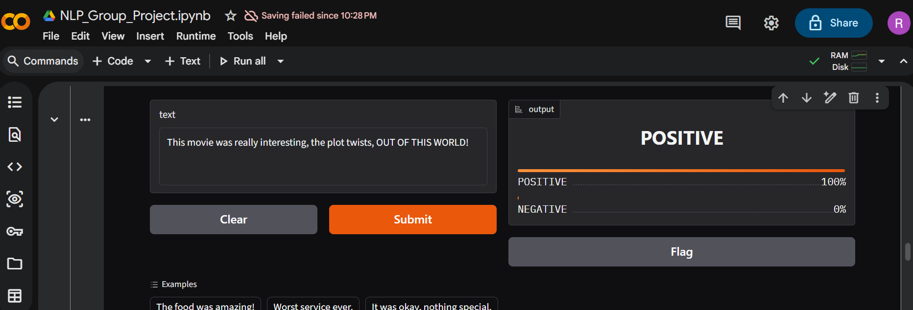
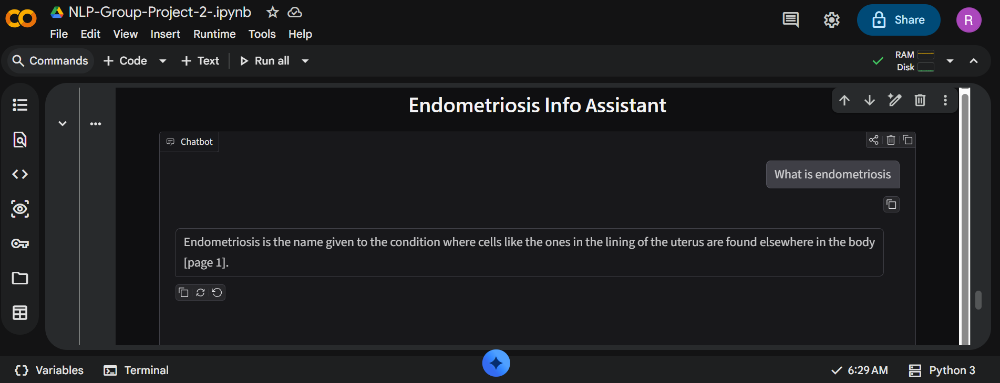
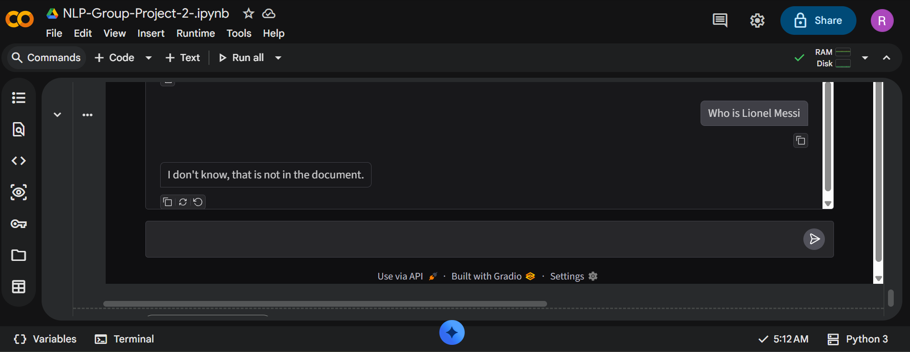

# Group NLP Project
Members: NTALE RAIDAH AND NAWE ABASA

## App 1: Sentiment analyser
- Model: https://huggingface.co/RaidahAhmed/RaidahandNawe-sentiment-model
- Screenshots: NLP-EXAMPLE.png, NLP-API-TESTING.png, chatbot-2.png, chatbot-3.png
- Test accuracy: 0.91  Test F1: 0.9106
- How to run the API:
  ```
  pip install -r requirements.txt
  uvicorn main:app --reload
  ```
- Example: send {"text": "I love this"} to /predict
  -> {"label": "POSITIVE", "score": 0.99}




## App 2: Document chatbot
- Screenshots:  chatbot-2.png, chatbot-3.png
- Document used: Understanding-endometriosis- pack_0.pdf
- Test results:
  
| **Question** | **Right page found?** | **Answer correct?** | **Invented anything?** |
|---|:---:|:---:|:---:|
| 1. What is endometriosis? | Yes | Yes | No |
| 2. How common is endometriosis? | Yes | Yes | No |
| 3. Give me ten symptoms of endometriosis. | Yes | Yes | No |
| 4. Who won the 2026 World Cup? (Not in PDF) | No | No | No |
| 5. Where is WITU located? (Not in PDF) | No | No | No |

- What broke and how we fixed it:
  1. **Hugging Face LLM options all required payment**, so we ran a small open model (Qwen2.5-1.5B-Instruct) inside Colab instead.
  2. **The bot did not cite page numbers.** The small model ignored the rule at the top of the prompt. We moved a reminder to the end of the user message
  3. **Follow-up questions failed.** When we asked "Tell me more about that", the bot said it didn't understand what "that" meant, we left it as a known limitation.
  4. **Rude messages.** When we said "you are a useless bot", the bot apologized, Off-topic questions (Lionel Messi) were handled correctly with "I don't know, that is not in the document."
  5. **Safety for a health topic.** We added a rule that the bot is not a doctor and tells people to see a healthcare professional for personal medical concerns.




## Our model vs the LLM
Our fine-tuned DistilBERT is built for one job, sentiment, and it answers in a fraction of a second. The LLM can do many jobs with only a prompt, but it was slower on our test sentences, and on mixed-feeling sentences like "Not bad, but I expected more for the price" both models agreed throught.

We would use our small model when the task is fixed and we need speed, low cost and privacy, because it runs on our own machine with no internet and no usage fees. We would use an LLM when the task changes often, when we have no training data, or when we need flexible output such as extracting JSON from messy text.

## Limitations
- The sentiment model is trained only on English movie reviews, so it may be wrong on other topics, sarcasm, mixed opinions, and Luganda or mixed-language text. Reviews longer than 256 tokens are cut.
- The chatbot uses a small 1.5B model, so it can be wrong, make things up, or ignore instructions. It sometimes loses track of follow-up questions.
- The chatbot is not a doctor and gives information from one document only. It is not medical advice.

## Who did what
- Raidah: Part 1 (training and comparing the models, saving the model), uploading the model and writing the model card, the Gradio demo, the FastAPI app and its tests (Screenshots 1 and 2).
- Nawe: the LLM comparison, the PDF chatbot (chunking, embeddings, retrieval, prompts and the page-number fix), testing the bot and (Screenshots 3 and 4), `chatbot_app.py`.
  
-Both of us: We both worked on this README.


